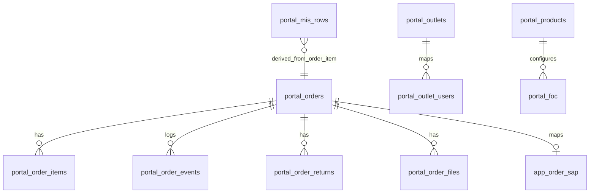

# STRAVEDA — Database Schema Reference

This document supplements the [Technical Project Documentation](STRAVEDA_TECHNICAL_DOCUMENTATION.md). It describes the database model visible in the repository's reference schema and the runtime tables created by the Android client.

## 1. Database layers

STRAVEDA has two related schema layers:

1. **Bundled seed schema:** The SQLite database at `source-code/client/assets/database/rohan_energy_demo.db`, created from the demo dataset and checked against `source-code/03-demo-data/schema.sql` and `json/portal_*.json`.
2. **Runtime extensions:** Local tables and indexes initialized by `app/_layout.tsx`, `src/session.ts`, `src/order-workflows.ts`, and `src/mis-history.ts`.

The reference `schema.sql` describes the original portal-shaped MySQL schema. The Android runtime uses SQLite. The schema concepts are carried over, but SQLite type declarations/storage behavior should be treated as authoritative for the actual bundled database.

## 2. Entity relationship overview



The relationship from MIS to orders is represented through `portal_mis_rows.item_id` and the originating order item. The SQL reference's declared foreign keys explicitly cover order child records, outlet-user-to-outlet validation in tests, and product-to-FOC validation in tests.

## 3. Reference portal tables

### 3.1 Configuration and catalogue

| Table | Primary key | Important columns | Description |
|---|---|---|---|
| `portal_settings` | `skey` | `svalue`, `updated_by`, `updated_at` | Key/value configuration. Keys include `rate_<pid>`, `gst_<pid>`, `stock_<pid>`, `cfg_stock_enabled`, `min_order_ea`, FOC metadata and permission switches. |
| `portal_products` | `pid` | `name`, `brand`, `created_by`, `created_at` | Product catalogue; product name is unique. Brand examples in the schema comments are `hp` and `tata`. |
| `portal_foc` | `id` | `pid`, `min_qty`, `foc_qty`, `created_by`, `created_at` | Free-of-cost threshold rules. Unique key on (`pid`, `min_qty`). |

### 3.2 Outlet master and outlet login

| Table | Primary key | Important columns | Description |
|---|---|---|---|
| `portal_outlets` | `sap_code` | `outlet_name`, `sheet_zone`, `zone`, `state`, `ro`, `district`, `sales_area`, contact, GST/PAN and invoice fields | SAP outlet master and billing snapshot source. |
| `portal_outlet_log` | `id` | `sap_code`, `action`, `changes`, `username`, `user_label`, `created_at` | History of outlet master changes. |
| `portal_outlet_users` | `sap_code` | `label`, `pass`, `pass_view`, `pass_by`, `pass_at`, `created_by`, `created_at` | One outlet login per SAP code; `pass` contains a bcrypt hash. |

### 3.3 Orders

| Table | Primary key | Important columns | Description |
|---|---|---|---|
| `portal_orders` | `id` | `order_ref`, `status`, `order_date`, geography, outlet and invoice snapshots, totals, creator, submitter/decision timestamps, `delivery_stage`, voucher/invoice fields, `placed_role` | Order header. Status values documented in schema: draft, pending, approved, rejected. Delivery stage includes transit and delivered for approved orders. |
| `portal_order_items` | `id` | `order_id`, `item`, `ea`, `vol`, `rate`, `gst`, `foc`, `paid` | Product lines. `ea` is paid plus FOC quantity; `vol` is litres. Unique by order and item. |
| `portal_order_events` | `id` | `order_id`, `action`, `from_status`, `to_status`, actor, organization, comment, timestamp | Append-style order lifecycle events. |
| `portal_order_returns` | `id` | `order_id`, `status`, `reason`, `credit_note`, requester and decision metadata | Return requests and decisions for delivered orders. |
| `portal_order_files` | `id` | `order_id`, `kind`, `orig_name`, `stored_name`, `mime`, `size`, uploader, timestamp | File metadata; file bytes are stored separately. Unique by order and file kind. |

**Order relationships:** `portal_order_items`, `portal_order_events`, `portal_order_returns`, and `portal_order_files` reference `portal_orders(id)` with `ON DELETE CASCADE` in the reference schema.

### 3.4 MIS

| Table | Primary key | Important columns | Description |
|---|---|---|---|
| `portal_mis_rows` | `id` | `d`, sale type, outlet, SAP, location, district, state, sales area, RO, zone, item, `ea`, `litres`, `xs`, `src`, `item_id`, `gone`, `ver`, updater, timestamp, notes | MIS dataset. `src` distinguishes sheet rows from order-derived rows; `gone` hides a projection; `ver` supports concurrency checks. Unique index on `item_id`; index on date. |
| `portal_mis_meta` | `k` | `v`, `by`, `at` | MIS metadata and revision-style key/value state. |

### 3.5 Account and additional reference tables

- `officer_accounts`: local officer account data used by the app; the live PHP `users.php` is not a production account source in this repository.
- `audit_log`: reference/demo audit table created by the source portal's API workflow.
- `targets`: reference/demo sales targets, uniquely keyed by month, scope type and scope value.
- `portal_change_log`: reference change-log data.
  
The exact current columns should be checked against the bundled SQLite asset and reference source before making schema migrations to these tables. The Android implementation does not expose general user administration or target editing as a complete feature.

## 4. Android runtime extension tables

| Table | Key | Columns / rules | Purpose |
|---|---|---|---|
| `app_session` | `id = 1` | `username TEXT NOT NULL`, `org TEXT NOT NULL CHECK(org IN ('rohan','hpcl','outlet'))` | Stores only the local session account key. |
| `app_pending` | `id` | `d,sap,outlet,item,ea,status,submitted_by,zone,ro,state,sales_area,reason,decided_by,decided_at`; status constrained to pending/approved/rejected | Offline pending MIS submissions and decisions. |
| `app_history` | `id` | `actor,action,detail,at` | General local activity trail. |
| `app_order_sap` | `order_id` | `order_id` references `portal_orders(id)` with cascade; `sap TEXT NOT NULL` | Preserves the exact SAP association for an order. |
| `app_mis_history` | `id` | `row_id,actor,action,source,summary,at,sap,zone,ro,state,sales_area` | Detailed MIS change history. |
| `app_mis_import_batches` | `token` | `actor,inserted,at` | Prevents committing the same preview token twice. |

### 4.1 Runtime indexes

- `app_pending_active_once`: unique partial index over (`submitted_by`, `d`, `sap`, `item`, `ea`) for rows whose status is pending.
- `app_order_sap_sap`: index on `app_order_sap.sap`.
- `app_return_order_status`: index on (`portal_order_returns.order_id`, `status`).
- `app_mis_history_at`: descending index on MIS history ID.
- `app_mis_history_sap`: index on MIS history SAP.

## 5. Important fields and data semantics

| Field | Meaning |
|---|---|
| `pid` | Product identifier used by settings keys and FOC rules |
| `sap_code` / `sap` | Outlet SAP identifier |
| `ea` | Eaches / unit quantity; in order lines it represents paid plus FOC |
| `paid` | Paid order quantity, excluding FOC |
| `foc` | Free-of-cost quantity |
| `vol` / `litres` | Volume in litres; order workflow uses 20 litres per EA |
| `rate` | Per-EA price snapshot, ex-GST |
| `gst` | GST percentage snapshot |
| `src` | MIS source: `sheet` or `order` |
| `item_id` | Source order-item identity for order-derived MIS rows |
| `gone` | Visibility marker for an order-derived MIS projection |
| `ver` | MIS row version used to reject stale updates |
| `status` | Workflow state; valid values depend on the table |
| `delivery_stage` | Delivery progress for approved orders |
| `updated_at` / `decided_at` | Timestamps used for history and stock-baseline calculations |

## 6. Data integrity and transaction policy

- Enable foreign keys on each database connection using `PRAGMA foreign_keys = ON`.
- Verify `PRAGMA user_version` before using the database.
- Check `PRAGMA foreign_key_check` during initialization and tests.
- Keep multi-row operations inside SQLite transactions.
- Re-check authorization and record scope inside the transaction for sensitive writes.
- Use parameterized SQL; do not interpolate untrusted values into SQL identifiers or statements.
- Preserve decimal-like values in the representation expected by the seed and workflow calculations.
- Treat order-derived MIS rows as projections; hiding a projection must not delete its source order.
- Use unique constraints/indexes to prevent duplicate active pending submissions and duplicate order-item/file-kind combinations.

## 7. Dataset validation

The Python seed tests verify:

1. SQLite `PRAGMA integrity_check` returns `ok`.
2. `PRAGMA foreign_key_check` returns no violations.
3. Each `portal_*.json` source file has matching row counts in the SQLite table.
4. Seed row values match the source JSON data.
5. Product/FOC, outlet/outlet-user, and order-child relationships are valid.
6. Officer and outlet account hashes have bcrypt-compatible prefixes and expected hash length.
7. Decimal fields use SQLite TEXT storage where expected.
8. Schema version is 1 and expected runtime/reference tables and indexes exist.

Run the tests from `source-code/client/`:

```bash
npm run test:seed
```

## 8. Schema change procedure

Before changing the database:

1. Identify whether the change belongs in the committed seed schema, runtime extension, or both.
2. Update the reference schema and SQLite seed generation process where applicable.
3. Add a versioned migration strategy; do not silently change the meaning of schema version 1.
4. Preserve existing user data when a migration is required.
5. Add tests for new columns, indexes, foreign keys, constraints, and representative data.
6. Test fresh install and upgrade from the previous supported database version.
7. Re-run typecheck, domain tests, seed tests, and offline scan.
8. Update this schema reference and the technical documentation.

**Current implementation note:** The root layout rejects a database version other than 1. A general migration runner for future versions is not currently documented as implemented.

## 9. Authoritative files

- `source-code/03-demo-data/schema.sql` — reference portal schema.
- `source-code/client/assets/database/rohan_energy_demo.db` — committed SQLite seed.
- `source-code/client/app/_layout.tsx` — startup checks and initial runtime table creation.
- `source-code/client/src/session.ts` — `app_session`.
- `source-code/client/src/order-workflows.ts` — `app_order_sap` and order workflow queries.
- `source-code/client/src/mis-history.ts` — MIS history and import batch tables.
- `source-code/client/tests/database/test_seed.py` — seed/schema/integrity test contract.
- `source-code/client/tests/database/test_app_schema.py` — runtime schema tests.

---

**End of database schema reference**
