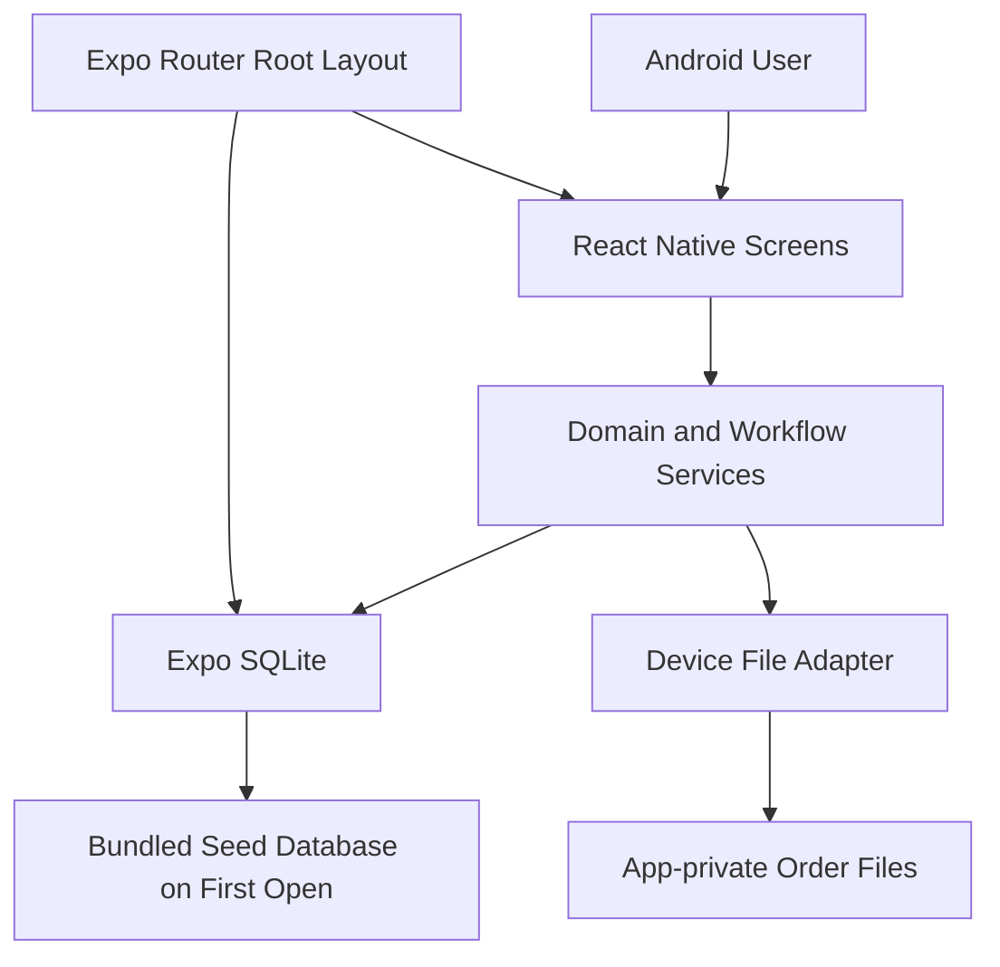
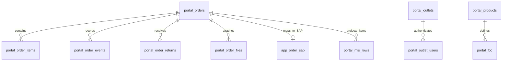
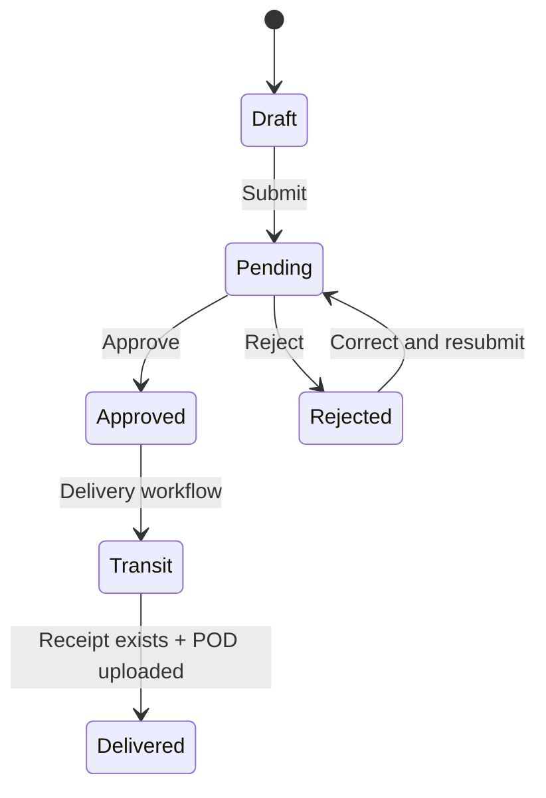

# STRAVEDA — Technical Project Documentation

**Project:** STRAVEDA — Offline Android Order & MIS Application  
**Reference business system:** Rohan Energy Order & MIS Portal  
**Platform:** Android  
**Documentation basis:** Repository `main` branch, application source, seed schema, test suite, and implementation reports  
**Application version:** 0.1.0  
**Package identifier:** `in.rohanenergy.offline`  
**Status:** Functional offline prototype; see verification and limitations sections before treating it as a production system.

---

## Document control

| Item | Value |
|---|---|
| Project name | STRAVEDA |
| Repository | [atharve16/Straveda-Tech](https://github.com/atharve16/Straveda-Tech) |
| Default branch reviewed | `main` |
| Application directory | `source-code/client/` |
| Android application ID | `in.rohanenergy.offline` |
| Expo slug | `rohan-energy-offline` |
| Application version | `0.1.0` |
| EAS project ID | `1588b446-83d5-4a51-b162-d97e425ea5c6` |
| Release profile | `production-apk` |
| Database asset | `assets/database/rohan_energy_demo.db` |
| Database version | SQLite `user_version = 1` |

> **Accuracy note:** This document describes the implementation visible in the repository. It distinguishes implemented behavior, source/reference data, automated verification, and prototype limitations. It does not claim live portal integration, cloud synchronization, or production deployment.

## 1. Executive summary

STRAVEDA is an Android application prototype that adapts selected workflows from the Rohan Energy Order & MIS Portal into a locally operated, offline-first mobile application. It is designed to let users authenticate against a bundled demonstration dataset, view role-scoped business information, create and process orders, manage local MIS records, review inventory availability, attach delivery/payment documents, and retain changes on the device.

The application is built with Expo, React Native, TypeScript, Expo Router, and Expo SQLite. A SQLite demonstration database is bundled with the application and imported into app-private storage. Runtime business operations use local database queries and transactions. Files attached to orders are stored in the application's private document directory.

The release configuration is designed to operate without runtime internet access: the production Android configuration blocks the `INTERNET` and `ACCESS_NETWORK_STATE` permissions. There is no application backend, remote API, Firebase service, cloud database, or cross-device synchronization in the current implementation.

Each installed copy is an independent local instance. A change made on one phone is not synchronized to another phone.

## 2. Problem statement and objectives

The reference portal provides order, sales/MIS, outlet, inventory, approval, and reporting workflows. A mobile offline prototype is useful where a user needs to demonstrate or exercise these workflows without depending on a live server connection.

The implementation objectives are to:

1. Package a known demonstration dataset with the Android application.
2. Authenticate users locally using the seeded account records and password hashes.
3. Rebuild identity and geographic scope from the local account records.
4. Enforce role and geographic rules in application domain services, not only by hiding UI controls.
5. Support order creation, approval/rejection, delivery evidence, and return requests.
6. Support scoped MIS viewing, entry, import, export, and audit history.
7. Calculate available stock from a locally stored baseline and approved order quantities.
8. Keep generated attachments and operational data within app-private device storage.
9. Provide a repeatable type-checking, test, offline-scan, and Android packaging workflow.

## 3. Scope

### 3.1 Included

- Android application built with Expo / React Native.
- Bundled SQLite demo database.
- Local authentication for seeded Rohan, HPCL, and outlet identities.
- Persistent local login session restoration.
- Role- and geography-scoped dashboard and business screens.
- Order drafts, multi-item lines, approval/rejection, payment receipt and proof-of-delivery attachments, and return requests.
- MIS data display, direct entry, editing, deletion, CSV import preview/commit, CSV export, and history.
- Inventory availability calculation and Rohan Super Admin stock controls.
- Local profile password changes.
- Local order document/voucher viewer.
- Android status-bar safe-area support and hardware Back navigation.

### 3.2 Excluded or intentionally limited

- Server APIs, backend hosting, remote authentication, and cloud database.
- Multi-device synchronization or shared live operational data.
- Creation/deletion of user accounts and broad user administration.
- Editing of product master data, outlet master data, prices, and FOC schemes through the app.
- Full editing of zone/team/organization/permission master data.
- Public server invoice QR verification.
- Automated in-app restoration of the original demo database.
- Full parity with every feature of the original PHP portal.

See [Known Limitations](../source-code/client/docs/KNOWN_LIMITATIONS.md) and [Module Implementation Status](../source-code/client/docs/MODULE_IMPLEMENTATION_STATUS.md).

## 4. Technology stack

| Layer | Technology | Responsibility |
|---|---|---|
| Language | TypeScript | Application and domain code |
| Mobile framework | React Native 0.88.1 | Native Android UI |
| Application framework | Expo SDK 58 | Runtime, native module integration, build configuration |
| Navigation entry | Expo Router ~58.0.32 | Root route and application entry |
| Local database | Expo SQLite ~58.0.18 | Embedded SQLite database and transactions |
| UI runtime | React 19.3.0 | Component rendering and local UI state |
| Safe areas | react-native-safe-area-context ^5.11.1 | Android status-bar and display-cutout insets |
| Password verification | bcryptjs ^3.0.3 | Local bcrypt password-hash verification |
| File selection | expo-document-picker ~58.0.5 | Native document picker |
| File storage | expo-file-system ~58.0.14 | App-private document storage |
| File sharing | expo-sharing ~58.0.23 | Android share sheet |
| Type checking | TypeScript ~6.0.3 | Static type checking |
| Unit/workflow tests | Node.js native test runner (`node:test`) | Domain and workflow regression tests |
| Database tests | Python 3 `unittest` + `sqlite3` | Seed schema, integrity, and relationship tests |
| Android build | Expo Application Services (EAS) | Cloud APK generation |

### 4.1 State management — Redux clarification

**Redux is not used in this project.** There is no Redux Toolkit store, Redux reducer/slice architecture, or Redux middleware in the current application dependencies.

The current state approach is intentionally simpler:

- React component state manages screen-local UI state, forms, filters, modal visibility, and selected tabs.
- The root application component manages the active main screen and navigation-related state.
- A dedicated navigation module provides testable hardware Back behavior and tab-history operations.
- SQLite is the persistent source of truth for business data.
- Session restoration reads the saved account key and reconstructs the actor from current local account records.

No Redux replacement package such as Zustand or MobX is configured. If global state grows in a future version, a state library should only be introduced after a concrete need is established.

## 5. System architecture

### 5.1 Architectural style

The application uses a local, layered architecture:

1. **Presentation layer:** Expo Router root route, screen components, navigation components, and reusable UI.
2. **Domain/workflow layer:** TypeScript modules implementing authentication, authorization, orders, MIS, stock, profile, and workflow rules.
3. **Persistence layer:** Expo SQLite with parameterized SQL and transactional writes.
4. **Device adapter layer:** Expo document picker, file system, and sharing APIs.
5. **Seed/reference layer:** Bundled SQLite database and the separately maintained reference PHP/demo-data inputs.

### 5.2 Runtime data flow



Business data is read from and written to the local SQLite database. Order attachment bytes are stored in the app-private file directory; metadata and file references are stored in SQLite. The production application is not designed to send this data to a remote service.

### 5.3 Startup sequence

The configured startup path is:

1. Expo Router loads `expo-router/entry`.
2. `app/_layout.tsx` initializes the safe-area provider and Android status-bar appearance.
3. `SQLiteProvider` opens `rohan_energy.db` using the bundled `rohan_energy_demo.db` asset as its seed source.
4. The initialization callback enables SQLite foreign keys.
5. It checks `PRAGMA user_version`, required core tables, and foreign-key integrity.
6. It creates/initializes runtime extension tables and indexes.
7. It runs order-file orphan recovery where possible.
8. The root route renders the application UI.

The SQLite provider is configured with `useSuspense`; the root layout displays a loading fallback and a database error boundary with retry behavior.

**Device-specific caveat:** Source configuration and automated database tests do not prove every first-install or process-restart behavior on every Android device. Those require physical APK validation.

## 6. Repository and application structure

The repository is organized into reference inputs, the Android client, and documentation.

```text
Straveda-Tech/
├── README.md
├── .easignore
├── documentation/
│   └── STRAVEDA_TECHNICAL_DOCUMENTATION.md
├── source-code/
│   ├── 02-web-portal-source/       # Reference PHP portal; not part of APK runtime
│   ├── 03-demo-data/
│   │   ├── schema.sql              # Reference MySQL schema specification
│   │   └── json/                   # Demo seed data files
│   └── client/
│       ├── app/
│       │   ├── _layout.tsx         # Root providers, SQLite startup, initialization
│       │   └── index.tsx           # Main application route and screen composition
│       ├── assets/
│       │   └── database/
│       │       └── rohan_energy_demo.db
│       ├── src/
│       │   ├── components/         # Shared UI and navigation components
│       │   ├── screens/            # Application screens
│       │   ├── theme/              # Theme tokens and presentation constants
│       │   ├── domain.ts           # Actor, login, scope, and core domain reads
│       │   ├── session.ts          # Persistent local session
│       │   ├── navigation.ts       # Hardware Back and tab history rules
│       │   ├── order-workflows.ts  # Order lifecycle and related operations
│       │   ├── order-files.ts      # Attachment selection, storage, and sharing
│       │   ├── order-file-validation.ts
│       │   ├── mis-workflows.ts    # MIS operations and CSV workflow
│       │   ├── mis-history.ts      # MIS audit history and import batch tracking
│       │   └── stock.ts            # Stock baseline and availability logic
│       ├── tests/
│       │   ├── database/           # Python SQLite seed/schema tests
│       │   └── *.test.mjs          # TypeScript domain/workflow tests
│       ├── scripts/
│       │   └── check_offline.py
│       ├── docs/                   # Engineering, audit, build, and QA documents
│       ├── app.config.js
│       ├── eas.json
│       ├── metro.config.js
│       ├── package.json
│       ├── package-lock.json
│       └── tsconfig.json
└── android/                        # Empty repository placeholder; EAS generates native build
```

This is a representative structure, not an exhaustive listing of every component or screen. The exact current tree in GitHub remains authoritative.

### 6.1 Important source modules

| File/module | Responsibility |
|---|---|
| `app/_layout.tsx` | Root safe-area/status-bar setup, SQLite provider, startup validation, runtime table initialization |
| `app/index.tsx` | Main app shell, current screen composition, hardware Back listener integration |
| `src/domain.ts` | Actor model, login, session actor reconstruction, scope predicates, core reads |
| `src/session.ts` | Store/restore/clear the single local session |
| `src/navigation.ts` | Pure back-navigation priority logic and main-tab history |
| `src/order-workflows.ts` | Order draft, submit, decision, details, delivery, return workflows |
| `src/order-files.ts` | Document picker, private file copy, metadata coordination, Android sharing, orphan recovery |
| `src/mis-workflows.ts` | MIS CRUD, CSV preview/commit, validation, transactions |
| `src/mis-history.ts` | Append-only MIS history and import-batch tokens |
| `src/stock.ts` | Stock setting, usage calculation, enforcement toggle |
| `src/components/` | Reusable layout, controls, navigation, and common components |
| `src/screens/` | Feature screens and their UI interactions |

## 7. Application modules and functionality

| Module | Main capabilities | Implementation boundary |
|---|---|---|
| Dashboard | Scoped order/MIS/pending counts, volume, recent records, quick actions | Values are derived from local SQLite |
| Authentication | Rohan, HPCL, and outlet login; bcrypt verification | Uses bundled demonstration accounts |
| Orders | Multi-line draft, edit, submit, list, details, approval/rejection | Local workflow; status changes are transactional |
| Delivery / POD | Receipt attachment, POD attachment, delivered stage | Receipt must exist before POD |
| Returns | Request, reason/credit note, approve/reject | Return decisions do not rewrite original order totals |
| Approvals | Pending order and MIS pending-entry decisions | Domain functions re-check actor and record state |
| MIS | Scoped records, direct entry/edit/delete, raw data, history | Order-derived rows are hidden rather than physically deleted |
| CSV import | File selection, preview, valid/skipped/rejected counts, atomic commit | Import is append-oriented; invalid/out-of-scope rows block commit |
| CSV export | Scoped export and Android sharing | Uses local data and native share sheet |
| Inventory | Product list, FOC tiers, available stock | Product and price masters are read-only |
| Profile | Current profile and password change | Current password must be verified |
| Reports | Local RO/volume/order summaries | Based on available local demo data |
| Admin previews | Zones, team, outlets, permission matrix | Informational/read-only areas where documented |
| Document viewer | Local order voucher/tax invoice presentation | No public online invoice verification QR |

## 8. Authentication, identity, and authorization

### 8.1 Local login

The application authenticates against local SQLite records:

- Officer identities are stored in `officer_accounts`.
- Outlet identities are stored in `portal_outlet_users`.
- Password hashes use bcrypt formats compatible with PHP's `$2y$` prefix. The client normalizes the prefix for bcryptjs verification.
- Login checks the selected organization for officer accounts.
- Outlet identity and geographic scope are derived by joining the outlet user record to its master outlet record.

The demonstration dataset contains 10 officer accounts and 10 outlet login records. These are demo identities, not a live production roster.

### 8.2 Persistent session

The `app_session` table stores one row (keyed by `id = 1`) containing only:

- `username`
- `org` (`rohan`, `hpcl`, or `outlet`)

It does not store the password or a serialized authorization object. On restoration, the app reloads the current account data, reconstructs the actor and scope, and clears the saved session if the account is missing, disabled, invalid, or inconsistent.

### 8.3 Geographic scope

The actor model includes organization, role, level, zone, regional-office list, sales-area list, state list, and optional outlet SAP identity. The `inScope` domain predicate applies the applicable boundaries:

- Outlet users are restricted to their own SAP code.
- Super Admin users are constrained by configured states when a state list exists.
- Other officers are constrained by assigned zone and, where present, regional-office and sales-area assignments.

The UI may hide actions or pages, but domain functions independently check authorization and record scope before sensitive reads or writes.

### 8.4 Role summary

The demo model includes Rohan Super Admin, HPCL Super Admin, Rohan/HPCL zone and regional officers, and outlet users. Exact decision eligibility depends on organization, role, level, creator/placed-role, record status, and geography. The executable domain code is authoritative; the reference PHP role matrix is not automatically identical to the offline implementation.

## 9. Database and dataset documentation

### 9.1 Database files and lifecycle

| Item | Detail |
|---|---|
| Seed database file | `source-code/client/assets/database/rohan_energy_demo.db` |
| Runtime database name | `rohan_energy.db` |
| Engine | SQLite |
| Access library | Expo SQLite |
| Schema version | `PRAGMA user_version = 1` |
| Seed file size | 229,376 bytes |
| Seed SHA-256 | `99A1D1154B1343111D4DFD29E568ACB01A85E806CC8C1C0B8DC0DFEC0526004A` |
| Runtime location | Application-managed private database storage |
| Foreign keys | Enabled during initialization |

The MySQL reference schema in `source-code/03-demo-data/schema.sql` is the source specification for the portal-shaped data model. The committed SQLite asset is the runtime database. SQLite affinity and type declarations differ from MySQL; in particular, decimal-like business values are stored as TEXT in the SQLite seed to preserve decimal representations rather than relying on binary floating-point storage.

### 9.2 Seed dataset

The reference demo-data directory contains `schema.sql` and JSON seed files named by portal table (the test suite reads `json/portal_*.json`). The SQLite seed is checked against those JSON files for row counts and field-value parity.

The principal seeded data groups are:

- **Configuration:** `portal_settings` — key/value settings such as rates, GST, stock baselines, minimum order and feature switches.
- **Products and offers:** `portal_products`, `portal_foc`.
- **Geography and outlet master:** `portal_outlets`.
- **Outlet authentication:** `portal_outlet_users`.
- **Orders and history:** `portal_orders`, `portal_order_items`, `portal_order_events`, `portal_order_returns`, `portal_order_files`.
- **MIS:** `portal_mis_rows`, `portal_mis_meta`.
- **Officer accounts:** `officer_accounts` is the local demo account table; the original portal's live account file is not included as a live production roster.

The exact row contents are demo data. Do not publish passwords, personal information, or sensitive business records from the seed in an external assignment. Use table-level descriptions and sanitized examples.

### 9.3 Core relational model



The order child tables use foreign keys with cascading deletion in the reference schema. The local seed tests verify the principal order-to-item/event/return/file relationships and outlet-user/product-FOC references.

### 9.4 Database table reference

The main portal-shaped tables are:

| Table | Purpose | Key data |
|---|---|---|
| `portal_settings` | Key/value configuration | `skey`, `svalue`, `updated_by`, `updated_at` |
| `portal_products` | Product catalogue | `pid`, `name`, `brand`, creator and timestamp |
| `portal_foc` | Free-of-cost tiers | `pid`, `min_qty`, `foc_qty`; unique product/threshold |
| `portal_outlets` | SAP outlet master and billing data | SAP key, name, zone, state, RO, district, sales area, contact and invoice fields |
| `portal_outlet_log` | Outlet master change history | SAP, action, changes, actor and timestamp |
| `portal_outlet_users` | Outlet login records | SAP key, label, bcrypt hash, password metadata |
| `portal_orders` | Order header and lifecycle | reference, status, date, geography, outlet snapshot, totals, creator, decision, delivery and invoice fields |
| `portal_order_items` | Product lines per order | order, item, EA, litres, rate, GST, FOC, paid quantity |
| `portal_order_events` | Order status/audit events | order, action, from/to status, actor, comment, time |
| `portal_order_returns` | Return and credit-note requests | order, status, reason, credit note, requester and decision metadata |
| `portal_order_files` | Attachment metadata | order, kind, original/stored name, MIME, size, uploader and time |
| `portal_mis_rows` | MIS rows and order projections | date, outlet/SAP/geography, item, EA, litres, source, item reference, hidden/version/audit fields |
| `portal_mis_meta` | MIS metadata | key, value, actor, timestamp |

Additional seed/runtime tables include `officer_accounts`, `audit_log`, `targets`, and `portal_change_log`. Their detailed source behavior is described in the audit documents. Runtime extension tables are documented below.

### 9.5 Runtime application tables

These tables are created or initialized by application startup/workflow modules and extend the bundled seed without changing the committed seed asset:

| Table | Created by | Purpose / important fields |
|---|---|---|
| `app_session` | `src/session.ts` | Single local session row; username and organization only |
| `app_pending` | `app/_layout.tsx` | Local pending MIS entry queue; date, SAP, outlet, item, EA, status, submitter, geography, decision fields |
| `app_history` | `app/_layout.tsx` | Local action trail; actor, action, detail, timestamp |
| `app_order_sap` | `src/order-workflows.ts` | Order-to-SAP mapping; order ID primary/foreign key and SAP code |
| `app_mis_history` | `src/mis-history.ts` | MIS create/edit/delete/import history; row, actor, action, source, summary, geography and timestamp |
| `app_mis_import_batches` | `src/mis-history.ts` | Import idempotency tokens; token primary key, actor, inserted count and timestamp |

Additional indexes include `app_pending_active_once` (prevents duplicate active pending entries by submitter/date/SAP/item/EA), MIS history indexes, SAP lookup index, and a return order/status index.

### 9.6 Important database constraints and conventions

- Foreign-key enforcement is enabled at startup.
- Schema version must equal 1; unsupported versions stop startup with an error.
- Startup checks required core tables and `PRAGMA foreign_key_check`.
- Product names are unique; FOC rules are unique by product and minimum quantity.
- Order item names are unique within an order.
- An order may have one file per attachment kind.
- MIS uses `src='sheet'` for manually/imported sheet rows and `src='order'` for order-derived rows.
- `gone=1` hides an order-derived MIS projection without deleting the original order.
- MIS `ver` supports stale-edit detection.
- Order child rows cascade when the parent order is deleted.
- Parameterized SQL is used for data operations; write workflows use exclusive SQLite transactions where atomicity is required.
- Decimal-like fields are preserved as text in the seed and interpreted by workflow code.

For the complete source DDL, consult [`source-code/03-demo-data/schema.sql`](../source-code/03-demo-data/schema.sql). For exact current runtime extensions, consult `app/_layout.tsx`, `session.ts`, `order-workflows.ts`, and `mis-history.ts`.

## 10. Business rules and workflows

### 10.1 Order lifecycle



- Drafts can contain 1–20 distinct product lines.
- Paid EA must be a whole number in the supported range.
- The applicable FOC tier is the highest threshold not exceeding the paid quantity.
- Total EA = paid EA + FOC EA.
- Volume is calculated at 20 litres per EA.
- Submission rechecks order minimum, product availability, stock, price and GST configuration.
- Approval rechecks scope, pending state and stock within a transaction.
- Payment receipt must be attached before POD upload.
- POD upload moves the delivery stage to delivered.
- Returns can be requested against delivered orders; return decisions are stored separately and do not mutate the original order quantities, invoice, or stock history.

### 10.2 Inventory calculation

When a stock baseline exists for a product:

`Available stock = Saved baseline − Approved order EA consumed since the baseline timestamp`

The calculation counts approved order item EA, including FOC quantity. Draft, pending, and rejected orders do not consume stock. If no stock baseline exists, stock is treated as unlimited. Only a Rohan Super Admin can change stock settings or enable/disable stock enforcement.

### 10.3 MIS rules

- MIS rows are scoped to the actor's geographic permissions.
- Direct entry validates date, SAP/outlet, item, and positive EA.
- CSV import supports a preview before commit.
- Blank lines can be skipped; invalid or out-of-scope rows block the atomic commit.
- Import batches are protected against accidental duplicate commit using a token.
- Sheet-origin rows are physically deleted when deleted.
- Order-derived rows are hidden with `gone=1`, preserving the original order.
- MIS history records create, edit, delete, and import activity.
- Export includes rows within the actor's current scope.

### 10.4 Password change

The signed-in user must prove the current password. The new password hash is saved locally. For outlet records, the legacy readable `pass_view` field is cleared. A password update on one device does not update another installation.

## 11. Local file and document handling

Order attachments are selected using the native document picker. The application:

1. Copies the selected file into the app-private `order-files/` directory.
2. Enforces a non-empty file and a maximum size of 10 MB.
3. Validates the file type using file signatures/magic bytes rather than trusting only the extension.
4. Stores attachment metadata in `portal_order_files`.
5. Removes replaced/orphaned files when safe to do so.
6. Re-checks that the file belongs to an order visible to the current actor before sharing.
7. Uses the Android share sheet for sharing a local attachment.

The supported formats documented by the application include PDF, Office documents, JPEG, and PNG. The exact validation rules are implemented in `src/order-file-validation.ts`.

## 12. Navigation, accessibility, and Android system UI

The app uses a single root Expo Router route with conditional screen composition. The main tabs include Home, Orders, MIS, Approvals, and More; nested screens and sub-sections are managed by application state.

The Android hardware Back handler follows this priority:

1. Close an open modal/overlay.
2. Close an active sub-section.
3. Reset an internal Orders, MIS, or Approvals sub-tab.
4. Return to the previously visited main tab.
5. Allow normal Android exit only from the root Home state (or the unauthenticated login state).

The application root uses `SafeAreaProvider`; the header and authentication screen use safe-area insets so interactive content stays below the Android status bar and display cutouts. The Android status bar remains visible.

These behaviors have been implemented and the user has confirmed both fixes on the target phone. Cross-device layout validation should still be performed if the app is distributed to a wider range of Android hardware.

## 13. Security and offline design

### 13.1 Offline controls

- Production Android configuration blocks `android.permission.INTERNET` and `android.permission.ACCESS_NETWORK_STATE`.
- The static offline checker scans `app/` and `src/` for obvious network references.
- No backend URL, API client, Firebase runtime, or cloud database is configured in the application dependencies.
- The EAS archive excludes reference PHP sources, demo JSON source files, docs, tests, scripts, and caches while retaining the SQLite database and runtime client.

**Verification limitation:** The static scan is not a proof of the final APK's merged manifest or every native dependency. The final APK should be inspected for internet permission and tested in airplane mode.

### 13.2 Local security controls

- Bcrypt password hashes are verified locally; plaintext passwords are not saved in `app_session`.
- Session restoration re-reads account data and recalculates scope.
- Domain functions check roles and geography before sensitive operations.
- SQL uses parameterized statements.
- Critical writes use SQLite transactions.
- Attachments are held in app-private storage and validated before use.
- The offline design reduces remote exposure but does not protect data from a compromised/rooted device or a person with access to the unlocked phone.

### 13.3 Data privacy

The database and generated attachments are local to the Android installation. There is no remote backup or synchronization in the current prototype. Users should treat device loss, uninstalling the app, or clearing application storage as potential data-loss events unless a separate backup procedure is established.

## 14. Development setup

### 14.1 Prerequisites

- Windows, macOS, or Linux development environment.
- Node.js 22 (the documented verification environment used Node.js 22.18.0).
- npm (use the committed lockfile).
- Python 3 for SQLite seed tests and offline scanning.
- Git.
- An Expo/EAS account for cloud Android builds.

Android Studio is not required for the configured EAS cloud build workflow. Device-level testing may use a physical Android phone.

### 14.2 Install and verify

From the repository root:

```bash
cd source-code/client
npm ci --include=dev
npx expo install --check
npm run typecheck
npm run test:domain
npm run test:seed
npm run check:offline
```

To start the configured development server:

```bash
npm start
```

The package script uses `expo start --dev-client`.

### 14.3 Package scripts

| Command | Purpose |
|---|---|
| `npm start` | Start Expo development server for dev client |
| `npm run typecheck` | Run TypeScript compiler without emitting files |
| `npm run test:domain` | Run domain, CSV, session, order, MIS, inventory, profile, and navigation tests |
| `npm run test:seed` | Run Python SQLite schema/seed tests |
| `npm run check:offline` | Static scan for obvious runtime network references |

## 15. Testing and verification

The repository's latest engineering report records:

| Verification | Recorded result |
|---|---:|
| TypeScript typecheck | Passed |
| Domain/workflow tests | 28/28 passed across 8 test files |
| SQLite seed/schema tests | 11/11 passed |
| Offline source scan | No runtime network references found in `app/` or `src/` |
| Expo Doctor | 19/20 checks passed; optional `expo-constants` peer dependency notice |
| EAS archive inspection | Passed; 49 non-Git files; seed database included |
| Physical safe-area and Back behavior | Confirmed by user on target phone |

The test suites cover domain scope and role boundaries, CSV parsing, persistent sessions, order workflows, MIS transactions/import history, stock calculations, profile password changes, and hardware Back navigation logic.

### 15.1 Recommended manual test matrix

| Test | Procedure | Expected result |
|---|---|---|
| Fresh install | Install APK and launch | Login screen opens and local database initializes |
| Airplane mode | Disable Wi-Fi/mobile data and use app | Core workflows remain usable |
| Login | Test valid and invalid demo credentials | Correct local authentication behavior |
| Session persistence | Force-stop and reopen | Saved actor is restored from local account data |
| Order lifecycle | Draft, submit, approve/reject | Valid status transitions and audit events |
| Delivery | Add receipt, then POD | Receipt gate enforced; delivered state recorded |
| Returns | Request and decide return | Return state changes without rewriting original order |
| MIS import | Preview and commit valid CSV | Accurate preview and atomic insert |
| MIS export | Export and share CSV | Android share sheet opens |
| Inventory | Set baseline and approve order | Available quantity recalculates |
| Navigation | Use hardware Back across nested screens | Returns through the navigation hierarchy; exits at root |
| System UI | Test different display sizes/cutouts | Header remains below status bar; no duplicated inset |
| Manifest | Inspect merged APK manifest | Internet permission absent in release build |

For the detailed QA procedure, see [Testing Documentation](../source-code/client/docs/TESTING_DOCUMENTATION.md).

## 16. Android release and EAS build

The application configuration is Android-only:

- Expo SDK 58.
- Package ID: `in.rohanenergy.offline`.
- EAS project ID: `1588b446-83d5-4a51-b162-d97e425ea5c6`.
- EAS profile: `production-apk`.
- Android build type: APK.
- Release configuration blocks internet and network-state permissions.

Run a cloud build only after committing/pushing the intended source revision and completing local verification:

```bash
cd source-code/client
npx eas-cli build --platform android --profile production-apk
```

To inspect the EAS archive without starting a cloud build:

```bash
npx eas-cli build:inspect --platform android --profile production-apk --stage archive --output <temporary-directory-outside-repository> --force
```

See [Build Instructions](../source-code/client/docs/BUILD_INSTRUCTIONS.md) and [Release Validation Report](../source-code/client/docs/RELEASE_VALIDATION_REPORT.md). A successful archive inspection is not the same as a successful cloud build or a complete physical-device release test.

## 17. Known limitations and risks

1. **Independent installations:** no synchronization, central reporting, or shared device state.
2. **Demo accounts:** fixed seeded demonstration accounts; no account creation or deletion.
3. **Read-only master data:** products, outlets, prices, and FOC tiers cannot be edited in the app.
4. **Limited administration:** zones, team hierarchy, permission matrix, organization details, and demo reset are previews or unavailable actions.
5. **No server invoice QR:** public invoice URLs are intentionally omitted to preserve the offline design.
6. **Demo data only:** the bundled dataset is a demonstration snapshot, not a live production database.
7. **No automated database reset:** the reset design is documented but not implemented.
8. **Device-local time and IDs:** timestamps and generated identifiers are local to each installation.
9. **Device storage risk:** uninstalling/clearing app data can remove the local operational database and attachments.
10. **Release verification:** final merged manifest and broad hardware compatibility should be checked on the built APK.

The original reference kit does not include all live production configuration/account files or the original MIS workbook template. The prototype therefore must not be described as a complete replacement for the live PHP portal.

## 18. Future enhancements

Potential future work, subject to assignment scope and stakeholder approval:

- Secure export/backup and restore of local data.
- A controlled master-data update/import workflow.
- More comprehensive automated UI and Android device tests.
- A formal migration framework for future SQLite schema versions.
- Expanded accessibility and localization.
- A documented synchronization architecture only if the product requirement changes from offline-isolated devices.
- A release signing, versioning, and distribution process.
- Additional audit/reporting capabilities after confirming business requirements.

These are proposals, not currently implemented features.

## 19. References within the repository

- [Root README](../README.md)
- [Client README](../source-code/client/README.md)
- [Architecture notes](../source-code/client/docs/ARCHITECTURE.md)
- [Business rules](../source-code/client/docs/BUSINESS_RULES.md)
- [Role and permission matrix](../source-code/client/docs/ROLE_PERMISSION_MATRIX.md)
- [Module implementation status](../source-code/client/docs/MODULE_IMPLEMENTATION_STATUS.md)
- [Known limitations](../source-code/client/docs/KNOWN_LIMITATIONS.md)
- [Offline verification](../source-code/client/docs/OFFLINE_VERIFICATION.md)
- [Testing documentation](../source-code/client/docs/TESTING_DOCUMENTATION.md)
- [Build instructions](../source-code/client/docs/BUILD_INSTRUCTIONS.md)
- [Release validation report](../source-code/client/docs/RELEASE_VALIDATION_REPORT.md)
- [Reference MySQL schema](../source-code/03-demo-data/schema.sql)

---

**End of document — STRAVEDA Technical Project Documentation**
